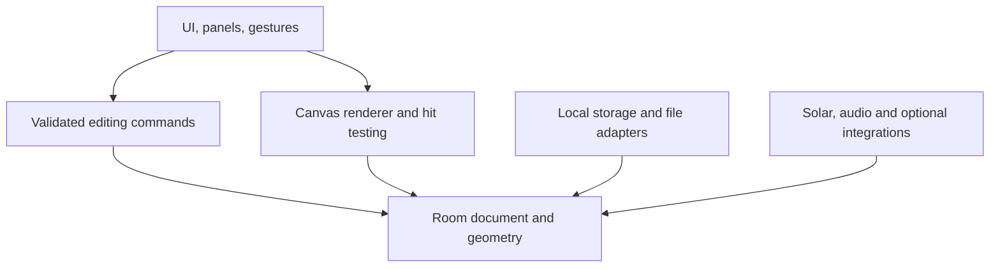

# Little Room next: architecture and delivery plan

**Status:** working design for an independent, browser-local rebuild. This document describes the target architecture and release criteria; an unchecked feature is not a claim that it already exists. The existing Little Room remains the production version until the replacement meets the migration and parity gates below.

## Why start again?

The first Little Room proved that a friendly, hands-on room planner is useful. Its editor, geometry, selection, tools, and persistence have grown together, so a change to a wall, opening, or furniture shape can affect many unrelated behaviors. The rebuild separates the **room document**, **editing operations**, **drawing**, **interface**, and **file adapters**. A developer should be able to add a new piece of furniture, replace a renderer, or add a new save destination without rewriting the editor.

The product remains a playful, tactile, top-down planner that works without an account. Floor plans and custom artwork stay on the user's device unless they choose to share them. It is a visualization tool, not a construction drawing or a building-code assessment.

## Product interaction model

1. **Floor plan mode** edits the physical plan: room/floor areas, walls, pillars, doors, windows, floor finishes, and reference-image tracing. A wall can be drawn directly from one point to another, with grid and endpoint snapping. Users can also enter starting dimensions or edit measurements numerically.
2. **Furnish mode** adds, draws, selects and rearranges furniture, rugs and other contents. Room geometry is locked from accidental edits. A drawn rectangle can be turned into a chosen catalog item at that footprint. Users can still pan, zoom and inspect dimensions without changing the room.
3. **Selection and layers** work in both modes, restricted to the active mode's editable entities. Support multi-select, select all eligible objects, clear selection, bring forward/send backward, hide/lock, move, resize, rotate, duplicate, mirror and delete. If “clear all” means removing content, present the exact scope and provide undo. Make selection controls available outside long-press and dragging.
4. A context menu offers common actions for a selected item or wall; expose essential actions through a visible inspector and keyboard-accessible controls as well. Touch, mouse and keyboard must reach the same core operations.
5. Choosing a wall offers add door/window; an opening slides along its host, has adjustable width and orientation, and remains attached when the wall changes. Walls can be full-height or half-height. Room-template placement is a preview, then an explicit commit that aligns geometry and preserves openings and contents.

## System boundaries

The arrows below describe dependency direction. Modules at the top make decisions by calling lower-level modules; the document and geometry know nothing about the DOM.

Recommended source boundaries:

| Boundary | Responsibility | Must not depend on |
| --- | --- | --- |
| Document | Serializable schema, IDs, units, validation and migrations | DOM, canvas, storage |
| Geometry | Polygons, wall paths, curve length, projections, snapping, transforms and intersections | UI state and pointer events |
| Commands | Validated atomic operations, undo/redo, multi-object transforms | Specific renderer or persistence provider |
| Catalog | Definitions, default dimensions, artwork and capabilities of object types | Hard-coded UI switch statements for every type |
| Editor/tools | Current mode, selection, viewport and pointer/keyboard gesture state | Persisted state mutations outside commands |
| Renderer | Read document and viewport, draw layers, return hit-test candidates | Storage and network |
| Persistence | Versioned JSON, editable PNG, migrations, local homes/templates and backup | Rendering implementation |
| Environment | Solar calculations, room orientation, optional atmosphere/audio | Hidden network lookups or assumptions about the user's location |
| UI | Controls, accessible alternatives, feedback, panels and context actions | Direct writes into the document |

Use a small dependency-free core where practical. Frameworks, WebGL/3D, external furniture packs, analytics or native wrappers may be adapters around the same model. Avoid assigning a single large editor class responsibility for all of these layers.

## Document model and geometry contracts

The following is a proposed logical schema, not a promise of the exact in-development wire format. Choose and document one versioned serialization before marking migration complete.

- A **document** has a format identifier and version, title, units, entities, ordered layers, environment settings, and references to embedded local assets. Use stable unique IDs and finite, bounded values. Store lengths in meters; format as metric or imperial in the interface. Document the coordinate system, angle direction and rotation origin in code and in the file-format specification.
- A **floor region** is an editable closed geometry with a finish/material. The model should eventually support irregular and curved outlines, multiple regions and holes rather than assuming one rectangular room. Adding a partition must never remove floor. Changes to floor should explicitly define how attached walls are affected.
- A **wall** is a path with endpoints, thickness and height; its path can be straight or curved. Connected segments need explicit, testable junction semantics so moving one shared point does not silently detach a neighbor. Half walls are a height value, not a separate drawing hack. Wall segments remain editable independently of the floor footprint.
- A **door or window** is a separately selectable entity with a host wall ID, an attachment position measured along the wall path, width, and direction/swing/mirror options where applicable. Its geometry derives from its host's local tangent and arc length. Validation must reject or explicitly resolve openings that do not fit, overlap, or would lose a host. Splitting, deleting, shortening, curving and joining walls require atomic remapping or a clear refusal that preserves the prior state.
- A **piece** has a stable type/definition ID, local geometry, transform, color/material, optional artwork and optional height. Transforms are local to the object, so a rotated non-square object stretches along the intended axes. A capability declaration controls whether it can be painted, reshaped, flipped, resized, or host other objects; unavailable operations explain why.
- **Layers** are explicit ordered references to entities rather than types. The user can place a chair below a desk or a table below a bunk bed. Rendering and hit testing must agree on ordering; hidden/locked entities have clear selection rules. Layer ordering alone does not imply physically accurate elevation or shadows.
- A **group or multi-selection** defines a common pivot and transforms its members together. For a room/template, transform the floor, walls and contents atomically; attached openings follow their hosts. A resize policy must say whether furniture and opening widths scale or retain real dimensions. Do not silently distort real measurements; preview and explain the chosen behavior.
- Custom images, traces and paint data are bounded, validated assets. Preserve original aspect ratio and editable transforms. A catalog item is a data definition plus optional renderer/capability adapters; adding a normal new item should not require changing selection, movement, duplication, export or layer code.

## Editing and gesture rules

- A command takes the current document and explicit parameters, validates the whole change, and either commits one new state/history entry or returns a useful error without mutation. Undo/redo is required for additions, deletes, geometry edits, transforms, material changes and template placement. Avoid storing transient pointers, timers, audio handles or UI focus in a room file.
- Pointer gestures have clear states: idle, candidate, drag, long-press, pinch and cancel. Movement thresholds and timing are shared across tools. A second touch or cancelled pointer must not leave half-applied geometry. Render a preview during a gesture; commit once on release.
- Wall drawing starts at the initial press, previews a snapped end and commits on release. Offer numeric length/angle, endpoint snapping and optional grid snapping. A double-tap or explicit action inserts a node on straight or curved edges; dragging moves it, and an explicit/hold menu may remove it when topology remains valid.
- Floor-plan mode and furnish mode must enforce their locks in the command layer, not only hide UI. Multi-select and “select all” clearly indicate what was selected and whether locked/hidden items are excluded.
- Every gesture has a discoverable alternative: visible context/inspector controls, numeric fields, object/layer lists, keyboard focus and keyboard actions where applicable. Provide meaningful names, focus management, target sizes, contrast and reduced-motion behavior. A canvas must have a non-canvas way to understand and select contents.

## Portable files and compatibility

The existing app writes JSON wrapped as `format: "little-room"` with versions 1 and 2 and embeds editable room data in an uncompressed PNG `iTXt` chunk. Its saved homes and templates live in browser storage. The replacement needs explicit adapters and representative fixtures for those inputs, including old cell-based rooms, polygon rooms, curves, custom drawings/images, openings, tracing references and template records. Use the original samples to test, not only files generated by the new code.

1. **Import**: read bytes with limits, recognize format/version, validate the complete input, migrate in memory, validate the result and present any unsupported features before replacing the open document. Unknown future versions fail safely. Failed imports and quota errors never destroy the current plan or the original saved record.
2. **Save locally**: use a versioned storage adapter. Large image assets need a deliberate size/storage policy; IndexedDB can be used when implemented, with a tested unavailable/full-storage path and JSON export fallback. Preserve legacy storage keys until an explicit successful migration; do not assume two different origins share storage.
3. **Export JSON**: serialize a canonical, versioned document with assets or a documented self-contained package. Round trips retain geometry, layering, references and editable properties.
4. **Export editable PNG**: render an image and include the validated document in standard Unicode-capable PNG `iTXt` metadata. Keep a separate human-readable render prompt in metadata and make that prompt copyable in the interface; an AI service is not assumed to read metadata automatically. Explain that image editors and messaging services may strip metadata, so keep a JSON backup. Verify metadata size/CRC and reject corrupted data safely.
5. **Privacy**: embedded data can include an exact location, hidden trace and custom images. Before export, clearly list what is included and allow removal. No analytics, geocoding, cloud storage or external AI call happens silently. Canvas assets must be local or loaded with appropriate cross-origin permissions to keep image export working.

## Sun, shadows and atmosphere

- Represent north orientation separately from the on-screen rotation of the room. For a real location, capture latitude/longitude and either a UTC instant or a local date/time **with an IANA time zone**; handle daylight saving and ambiguous or nonexistent local times deliberately. Manual coordinates work offline. A place-name lookup is an optional, consent-based adapter with a visible data destination, not a hard dependency.
- Compute sun azimuth and elevation with a documented solar-position algorithm and compare fixtures against trusted reference examples, including sunrise/sunset, time zones, seasonal changes and high latitudes. Sun below the horizon should not cast daytime sunlight. NOAA documents the underlying solar calculation approach at <https://gml.noaa.gov/grad/solcalc/calcdetails.html>.
- Distinguish solar position from the rendering of light. Window position, orientation and height; wall and object heights; obstruction; and local weather all influence the resulting shadow. A first 2D approximation may be useful but must be labeled illustrative. Any physically stronger model requires explicit inputs and separate validation.
- Forest, city/high-rise, ground floor, desert and jungle are optional atmosphere presets. Record visual/audio choices separately from physical location. Sounds start only after a user action, default off, and have volume/mute controls. Bundle licensed audio or use a clearly disclosed source; functionality must remain usable without sound or network access.

## Extensibility and integrations

- Catalog definitions are versioned data. Object creation, default dimensions, rendering, transform capabilities, validation and serialization have documented contracts. Unknown object types survive a round trip when safe, with a labeled placeholder; users should not silently lose content when a pack is unavailable.
- Templates are versioned portable fragments: geometry, contents, origin/pivot, attachment hints and asset references. Placement previews collision/alignment and commits atomically. ID remapping, wall-host references, openings, curves, layers and artwork must remain consistent. A template does not silently delete a section of the current floor.
- Future 3D or native apps should consume a documented document schema and geometry services through an adapter. Browser UI and Canvas APIs must not leak into model code. A hosted account, import from CAD or an AI renderer is a future opt-in provider, not part of the core's basic operation.
- A single known source tree, reproducible build and documented output path feed deployment. No special server, secret API key or account is necessary to open a saved local project.

## Prioritized roadmap and acceptance gates

### 0. Inventory and foundation

- [ ] Freeze a feature inventory and known limitations for the current app, with a mapping to the new version.
- [ ] Create the independent project, local run/build instructions, schema/coordinate notes and automated test command.
- [ ] Build pure geometry/document primitives, validation and reversible commands. Test invalid operations, undo and serialization.

### 1. Vertical slice: a dependable plan

- [ ] Create a dimensioned rectangular room; draw and move straight walls by dragging; snap to grid/endpoints; zoom and pan.
- [ ] Add a catalog item by tap, drag/drop or drawing a footprint; select, move, resize, rotate, mirror, duplicate and delete.
- [ ] Switch between plan and furnish with enforcement that prevents unintended room edits. Provide clear selection and undo.
- [ ] Save and reopen a project locally and in JSON. Test desktop and a narrow mobile viewport. State visibly which advanced features are not ready.

### 2. Complete the existing feature inventory

- [ ] Irregular and curved rooms and walls; editable and removable nodes; interior partitions; doors and stretchable windows; custom shapes, painting and image artwork; tracing; snapping; grid; naming; sizing and rotation; room templates; local home/template library; undo and reset.
- [ ] Existing local homes/templates and v1/v2 JSON and editable PNG import via tested migration; export and reopen without losing details. If a legacy shape cannot be represented, preserve a backup and report exactly what is unsupported.
- [ ] Restore optional feng-shui-inspired guidance with its original limitations clearly stated; never imply an algorithm accounts for partitions if it does not.
- [ ] Check every row in the separate feature inventory against a demonstration or test; gaps remain visibly marked.

### 3. New organization and room tools

- [ ] Layer management, selection list, select all/clear selection and clearly scoped undoable clear-all. Move, rotate and duplicate multi-selections.
- [ ] Wall-hosted doors/windows including interior walls, opening sliding/resize/mirror, curve edits and safe host remapping. Half walls, shelves and floor finishes.
- [ ] Whole-room resize with a transparent scaling policy; attached room-template preview, snapping, transform and safe placement.

### 4. Environment and polish

- [ ] Solar position from date, time, time zone, coordinates and plan north. Document accuracy, handle polar/night cases and distinguish visual shadow approximation from real lighting.
- [ ] Atmosphere presets and optional user-started sound with offline behavior and clear licensing.
- [ ] Editable PNG with room metadata and a copyable quick-render prompt. Include privacy choices and tests for altered/stripped metadata.

### 5. Release readiness before replacing v1

- [ ] Existing-feature parity, migration fixtures and a documented rollback; publish the replacement at a separate URL until accepted. Keep the original app and data available.
- [ ] Test keyboard, screen reader, contrast, mobile layout, larger text, reduced motion and the full save/reopen journey on physical iPhone/Safari and Android/Chrome. A desktop narrow viewport is not equivalent to a touch-device test.
- [ ] Verify current browser support, failure messages, memory/storage constraints, accessibility and performance on realistic plans. Include large images and long editing sessions.
- [ ] Document known limitations, deployment, release procedure, dependency licenses, security boundaries and integration APIs. Record any limitations in the product rather than claiming unsupported functionality.

## Test strategy

**Unit and property tests:** geometry projections, curves, snap distances, self-intersection, opening fit/remap, layers, transforms, dimensions and sunlight calculations. Include invalid/nonfinite inputs and edge cases. Commands must be atomic and undo/redo must recover the exact prior result.

**Compatibility fixtures:** representative v1/v2 JSON and PNG exports, including older formats and image-heavy rooms; corrupt/truncated/oversized files, unknown versions, storage unavailable/full, metadata removed, and repeated migrations. Confirm importing a bad file never replaces the open or saved room.

**Integration tests:** draw walls, place and slide openings, switch modes, reshape, layer, group, apply material, add template, save/reload and undo. Verify zoom/pan vs drawing/selection, long-press vs drag and cancellation/pinch. Test that render ordering and hit-test ordering agree.

**Human testing:** a new user should be able to enter dimensions, draw a partition, place a door, arrange furniture, save and reopen with mouse and with touch. Measure actual target devices and record failures; verify alternatives to precision dragging or color-only information. Solar and environmental visuals should not suggest measurement-grade accuracy.

## Definition of done for a feature

A feature is ready when its behavior and limits are understandable in the UI; document changes are validated and undoable; relevant old and new files survive a round trip; keyboard/touch alternatives are available; focused tests pass; and real-device or visual testing is recorded where interaction is central. Planned, partially built and fully shipped capabilities must be labeled separately.
